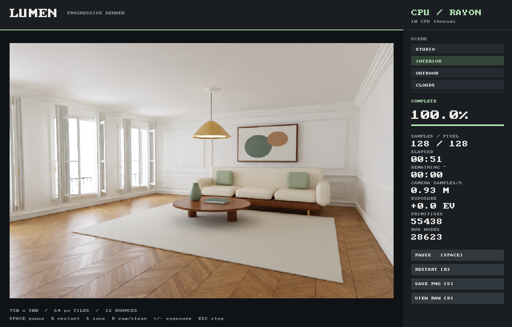
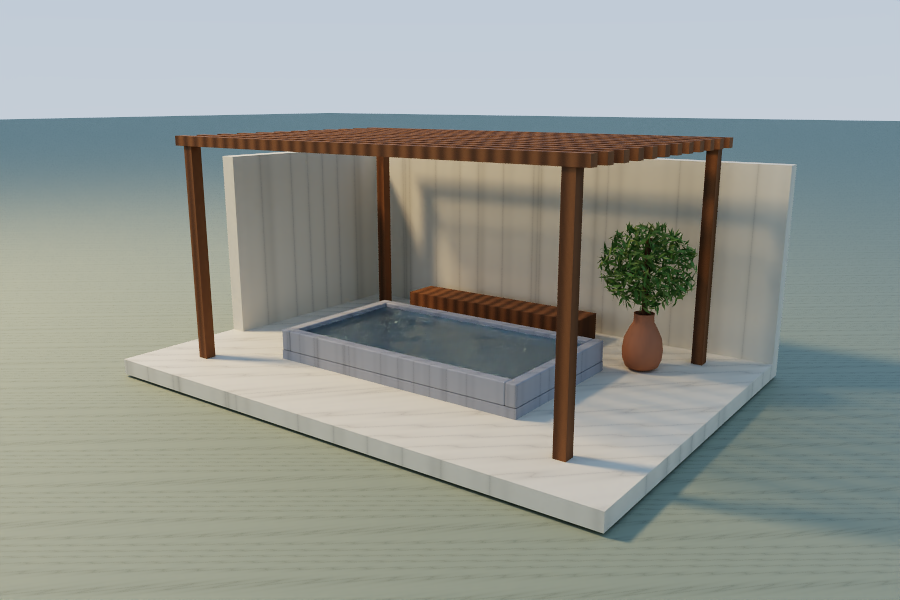

# Lumen

A Rust path tracer for Apple Silicon, with native Metal compute, a parallel CPU backend, and a desktop viewer that builds images tile by tile. The target is photorealistic final images, evaluated against Blender Cycles on an M1 Pro.



## Run

Install stable Rust and Xcode Command Line Tools on macOS, then:

```bash
cargo build --locked --release --bins
./scripts/setup-denoiser.sh
./target/release/viewer --backend metal --scene interior
```

The optional denoiser installer downloads a checksum-verified Open Image Denoise release into `.runtime/oidn`. It does not install system libraries. The viewer automatically filters complete passes when that runtime is available. Without it, rendering still works and the viewer reports raw mode.

Use `--backend cpu` for CPU rendering, or `--backend auto` to select an accessible Metal device. A restricted process may be unable to enumerate GPUs even when a normal Terminal session can. An explicitly requested Metal render fails clearly if no GPU is accessible.

The viewer schedules real 64 × 64 rendering tiles in center-first passes. The sidebar reports device, elapsed time, estimated remaining time, samples, camera sample throughput, primitive count and BVH size.

| Control | Action |
| --- | --- |
| Scene buttons | Studio, interior, outdoor or clouds |
| Space / Pause | Pause or resume between tiles |
| D / Raw–Clean | Toggle the current accumulation and the last denoised complete pass |
| R / Restart | Restart the scene |
| S / Save PNG | Export the displayed image to `renders/<scene>-live.png` |
| + / − | Adjust exposure without retracing |
| Escape | Stop an active render and retain its image |
| Close window | Cancel and exit |

The clean view updates at selected complete passes; the raw view shows each tile immediately. Denoising never modifies the Monte Carlo accumulators. Pause/cancel responsiveness is bounded by the current tile or synchronous denoising operation. Live timing includes pauses, filtering and UI backpressure.

```bash
./target/release/viewer --scene interior --samples 1024 --width 1200 --height 800
./target/release/viewer --scene outdoor --backend cpu --threads 10
./target/release/viewer --scene-file scenes/water-study.json --raw
```

## Render to files

```bash
./target/release/lumen-rs --list-devices
./target/release/lumen-rs --backend metal --scene interior \
  --width 1600 --height 1066 --samples 1024 --bounces 16 \
  --denoise --exr --output renders/final.png
```

Each render writes a PNG and a JSON performance report. `--exr` preserves linear RGB in OpenEXR. `--denoise` also saves the unfiltered result as `final-raw.png` and `final-raw.exr`. Compare raw and clean results when checking fine detail or caustics. PNG uses an ACES-style fitted curve followed by sRGB; this is not a full ACES color-management pipeline.

## Light transport and performance

- Multi-bounce global illumination, soft shadows, area-light sampling and multiple importance sampling.
- Lambert diffuse plus GGX reflections, with visible-normal microfacet sampling.
- Smooth dielectric transmission, exact dielectric Fresnel, total internal reflection, and Beer–Lambert absorption through up to 16 properly nested closed boundaries.
- Closed, displaced water meshes with time-dependent waves, refraction and absorption. Water is an optical model, not a fluid solver.
- A bounded participating medium with homogeneous or procedural cloud density, delta tracking, ratio-tracked shadow transmittance, multiple scattering and a Henyey–Greenstein phase function.
- Subpixel antialiasing, thin-lens depth of field, linear texture decoding and bilinear sampling.
- A flat 16-bin SAH BVH, near-first traversal, early-out shadow rays, stack-based path state, Russian roulette and Rayon parallelism.
- Native Metal compute with shared scene records and shared-memory image buffers. Offline rendering dispatches full-image batches and avoids intermediate film readbacks; the viewer uses interactive tiles. No per-bounce heap allocations.
- Optional adaptive sampling, disabled by default because statistical stopping can bias estimates and miss rare bright paths.
- Optional albedo/normal-guided Open Image Denoise filtering on CPU.

Caustic paths are represented by path tracing, but difficult specular-to-diffuse paths can converge slowly. There is **no dedicated caustic solver** yet. Denoising does not establish transport accuracy or remove that sampling limitation. Native Metal acceleration structures, wavefront scheduling and competitive speedups remain work to measure, not implemented performance claims.

## Scenes

| Studio | Interior | Outdoor |
| --- | --- | --- |
|  |  |  |

The interior contains individual 45-degree Hungarian-point chevron boards, beveled edges, scanned oak, opening glazed casements, jambs, sills, balcony rails, pleated curtains, layered mouldings, upholstered furniture and a shaped brass pendant. The daylight source outside the windows is an area-light approximation; the environment is a gradient.

The courtyard includes a closed wavy water volume, stone coping, a timber pergola and modeled leaves. The clouds preset demonstrates a procedural scattering volume; it is not a weather simulation or a measured atmospheric model.

Original geometry and the vessel generator are included. The scanned textures are redistributed under CC0; see [asset credits](assets/CREDITS.md).

## Import and scene files

```bash
./target/release/lumen-rs --scene studio --obj path/to/model.obj --obj-scale 0.1
./target/release/lumen-rs --scene-file scenes/glass-study.json --output renders/custom.png
```

OBJ import supports triangulation, normals, UVs, diffuse MTL texture maps, scaling, Y rotation and material overrides. Texture paths resolve relative to their MTL file. JSON paths resolve relative to the scene file. Scene units are meters; rotations are degrees. JSON materials support `texture`, `texture_scale` and `texture_strength`. Positive scale uses UVs; negative scale uses world projection.

See [glass](scenes/glass-study.json), [water](scenes/water-study.json), and [fog](scenes/fog-study.json) examples. Glass geometry must be closed and consistently wound. Cameras starting inside glass, arbitrary overlapping dielectric volumes, rough transmission, glTF, normal/roughness maps and mipmaps are not supported yet.

## Validate

```bash
cargo fmt --check
cargo clippy --locked --all-targets -- -D warnings
cargo test --locked
cargo test --locked --release --lib oidn_reduces_noise -- --ignored
./scripts/check-metal.sh
```

The OIDN test requires the optional runtime. The Metal test requires an accessible GPU and checks all four scenes, CPU/GPU luminance agreement, finite samples and exact GPU batch invariance. Those tests are explicitly ignored in the standard suite; an ignored test is not a GPU validation.

```bash
./target/release/viewer --headless-preview renders/viewer.png --scene interior --width 750 --height 500 --samples 128
```

The headless preview exercises UI drawing and tile integration; it does not verify native window events.

## Compare with Cycles

Install Blender, then run from a normal Terminal session:

```bash
python3 scripts/compare-cycles.py --backend metal --scene studio
python3 scripts/compare-cycles.py --backend metal --scene interior --output renders/cycles-interior
```

The script exports the assembled scene, renders independent high-sample references and repeated candidate images in each engine, and records linear RMSE, relative L2 error, high-percentile pixel error and process wall time. The report includes Blender version, device, settings and shader-mapping differences. Start with small dimensions to validate the pipeline. Read [the comparison protocol](docs/BENCHMARKING.md) before interpreting results.

For transport-only Lumen measurements:

```bash
python3 scripts/benchmark.py --backend both --repeats 3
```

Camera samples per second are not rays per second. Every sample can trace several path and shadow rays. No result in this repository establishes that Lumen is faster than a production renderer at equal final-image quality.

## Design

Read [architecture and Rust conventions](docs/ARCHITECTURE.md) and [the development priorities](docs/ROADMAP.md). Rust handles scene processing, transport on CPU, scheduling and the native application. The GPU kernel uses Metal Shading Language. Release builds use thin LTO.

Transport foundations follow [PBRT's path tracer](https://pbr-book.org/4ed/Light_Transport_I_Surface_Reflection/A_Better_Path_Tracer), [BVH construction](https://pbr-book.org/4ed/Primitives_and_Intersection_Acceleration/Bounding_Volume_Hierarchies), and [volume transmittance estimators](https://pbr-book.org/4ed/Volume_Scattering/Transmittance). Denoising uses the [Open Image Denoise C API](https://www.openimagedenoise.org/documentation.html).

MIT license. Copyright © 2026 Pierre CANGEMI.
