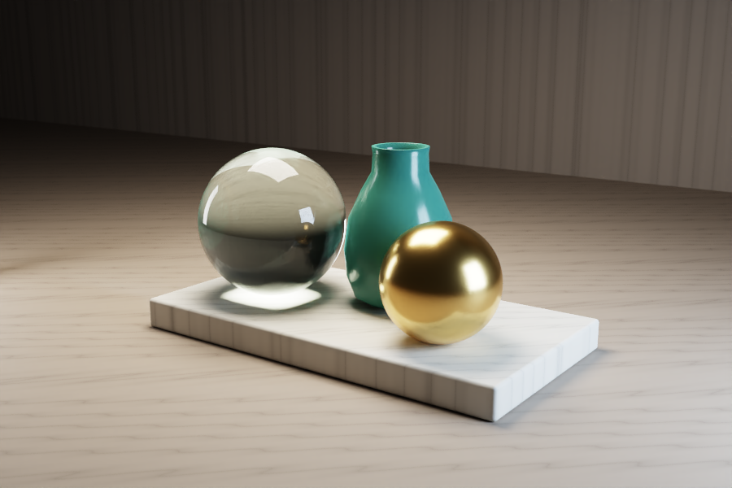
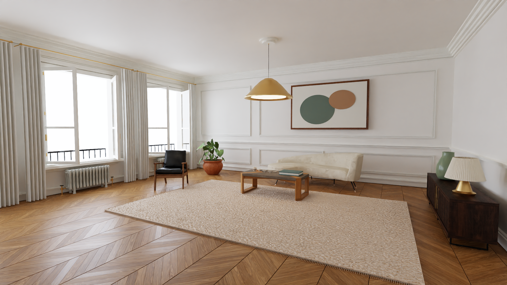
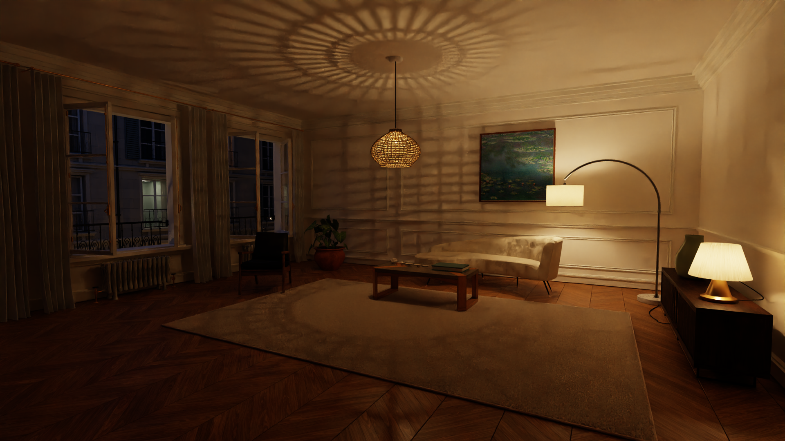

# Lumen

A Rust path tracer for Apple Silicon, with native Metal compute, a parallel CPU backend, and a desktop viewer that builds images tile by tile. The target is photorealistic final images, evaluated against Blender Cycles on an M1 Pro.


## Run

Install stable Rust and Xcode Command Line Tools on macOS, then:

```bash
cargo build --locked --release --bins
./scripts/setup-denoiser.sh
./target/release/viewer --backend metal --scene interior
```

Both rendering executables default to **1920 × 1080 (Full HD)**. Pass `--width` and `--height` to change the resolution.

The optional denoiser installer downloads a checksum-verified Open Image Denoise release into `.runtime/oidn`. It does not install system libraries. The viewer automatically filters complete passes when that runtime is available. Without it, rendering still works and the viewer reports raw mode.

Use `--backend cpu` for CPU rendering, or `--backend auto` to select an accessible Metal device. A restricted process may be unable to enumerate GPUs even when a normal Terminal session can. An explicitly requested Metal render fails clearly if no GPU is accessible.

The viewer schedules real 64 × 64 rendering tiles in center-first passes. The sidebar reports device, elapsed time, estimated remaining time, samples, camera sample throughput, primitive count and BVH size.

| Control | Action |
| --- | --- |
| Scene buttons | Studio, interior, interior-night, outdoor or clouds |
| Space / Pause | Pause or resume between tiles |
| D / Raw–Clean | Toggle the current accumulation and the last denoised complete pass |
| R / Restart | Restart the scene |
| S / Save PNG | Export the displayed image to `renders/<scene>-live.png` |
| + / − | Adjust exposure without retracing |
| Escape | Stop an active render and retain its image |
| Close window | Cancel and exit |

The clean view refreshes at complete passes, with at least three seconds between requests after the first preview. Tile outlines stay visible in both views. The footer identifies the current pass and the sample count of the displayed clean snapshot. A separate denoising worker and a bounded queue let rendering continue during filtering; a final filter is completed before reporting COMPLETE. Denoising never modifies the accumulators. Pause/cancel takes effect between tiles; an OIDN call already in progress finishes before its worker exits. Live timing includes preparation, pauses and filtering.

```bash
./target/release/viewer --scene interior --samples 1024 --width 1200 --height 800
./target/release/viewer --scene outdoor --backend cpu --threads 10
./target/release/viewer --scene-file scenes/water-study.json --raw
```

## Render to files

```bash
./target/release/lumen-rs --list-devices
./target/release/lumen-rs --backend metal --scene interior \
  --width 1920 --height 1080 --samples 1024 --bounces 16 \
  --denoise --exr --output renders/final.png
```

Each render writes a PNG and a JSON performance report. `--exr` preserves linear RGB in OpenEXR. `--denoise` also saves the unfiltered result as `final-raw.png` and `final-raw.exr`. Compare raw and clean results when checking fine detail or caustics. PNG uses an ACES-style fitted curve followed by sRGB; this is not a full ACES color-management pipeline.

## Light transport and performance

- Multi-bounce global illumination, soft shadows, area-light sampling and multiple importance sampling.
- Lambert diffuse plus GGX reflections, with visible-normal microfacet sampling.
- Smooth dielectric transmission, exact dielectric Fresnel, total internal reflection, and Beer–Lambert absorption through up to 16 properly nested closed boundaries.
- Thin clear-glass envelopes with Fresnel reflection and straight-through shadow transmission, plus diffuse-transmitting fabric and paper shades. These are thin-surface approximations; solid refractive volumes retain their separate transport model.
- Closed, displaced water meshes with time-dependent waves, refraction and absorption. Water is an optical model, not a fluid solver.
- A bounded participating medium with homogeneous or procedural cloud density, delta tracking, ratio-tracked shadow transmittance, multiple scattering and a Henyey–Greenstein phase function.
- Subpixel antialiasing, thin-lens depth of field, sRGB color decoding, linear data maps, tangent-space normal mapping and bilinear sampling.
- A flat 16-bin SAH BVH, near-first traversal, early-out shadow rays, stack-based path state, Russian roulette and Rayon parallelism.
- Native Metal compute with shared scene records and shared-memory image buffers. Both modes use 64 × 64 tiles, starting at one sample per submission and adjusting batch size from completed GPU timings toward a 20 ms command budget, capped at 16 samples. Offline rendering avoids intermediate film readbacks. No artificial delays or dropped samples; no per-bounce heap allocations.
- Optional adaptive sampling, disabled by default because statistical stopping can bias estimates and miss rare bright paths.
- Optional albedo/normal-guided Open Image Denoise filtering on CPU.

Caustic paths are represented by path tracing, but difficult specular-to-diffuse paths can converge slowly. There is **no dedicated caustic solver** yet. Denoising does not establish transport accuracy or remove that sampling limitation. Native Metal acceleration structures, wavefront scheduling and competitive speedups remain work to measure, not implemented performance claims.

Metal reports command count, total GPU command time, longest command and maximum batch size in each JSON report. The 20 ms target is a scheduling heuristic, not a hard latency guarantee: scene complexity, competing applications and system load can change execution time. A failed command stops the render with its driver diagnostic and sample range; partially written work is not silently retried.

### Samples and reflections

`--samples` controls camera paths per pixel. `--bounces` limits the number of surface or volume interactions along each path. Every path intersects the complete scene through its BVH, so increasing these settings does not enable additional objects: it improves convergence or admits longer chains of interactions. Russian roulette can end paths early, compensating the surviving paths' weights. The hard bounce limit still truncates longer paths.

For a longer Full HD night render:

```bash
./target/release/viewer --backend metal --scene interior-night --samples 2048 --bounces 50
```

This requests about 4.25 billion camera paths. Four times as many independent samples typically halves raw sampling noise and takes roughly four times the transport work. More bounces help when the current depth omits meaningful light paths; they do not repair incorrect geometry, materials or light intensity. More samples also do not force shadowed surfaces to become brighter. The current limits are 1,048,576 samples per pixel and 64 interactions; those are validation limits, not practical targets or guarantees of convergence.

## Scenes

| Studio | Interior | Outdoor |
| --- | --- | --- |
|  |  |  |

The interior contains Hungarian-point parquet, white painted timber casements with rounded meeting stiles, molded glazing beads, crémone hardware and subtly wavy glass. Irregular gathered curtains, cast-iron radiators and scrollwork balcony rails complete the window bays. Wall trim uses mitered profiles, with a continuous lower panel behind the sofa. The wool rug combines displaced backing with 58,200 short, rounded boucle loops, textured from the wool maps. Overlapping analytic beads form each thick cord without pointed tips or a long fringe. Only the table's two floor supports compress the pile; the open space between them retains its full wool depth. Existing furniture and plant meshes retain their texture maps.

`interior` and `interior-night` share the same camera and furnishing. The night version disables sunlight and switches on the sourced rattan pendant, sourced arc floor lamp and cabinet lamp. The pendant retains its full 80 mm glass bulb around a compact emitting element. Its masked source shade is replaced with interlaced cane following the original profile, projecting real woven shadows. Cloth lamp shades transmit light from their bulbs, and both floor-level leads reach plugs and a wall outlet. An exterior facade provides depth through the windows. Monet's *Water Lilies* is mapped, without stretching, onto a canvas centered within the large wall panel.

| Daylight | Evening lamps |
| --- | --- |
|  |  |

```bash
./target/release/viewer --backend metal --scene interior
./target/release/viewer --backend metal --scene interior-night
# Matching Full HD final images:
./target/release/lumen-rs --backend metal --scene interior --samples 128 --denoise --exr --output renders/interior.png
./target/release/lumen-rs --backend metal --scene interior-night --samples 256 --denoise --exr --output renders/interior-night.png
```

The lamps are existing generic source assets, not manufacturer-certified product replicas. Their emission is tuned for this scene, not calibrated in lumens. Wool loops use the opaque surface BRDF; dedicated fiber scattering and cloth simulation remain future work.

The opposite building has individually jointed stone courses, recessed window openings, molded white casements, slightly wavy reflective glazing, projecting sills, cornices, iron railings, shutters and downpipes. Separate rooms and gathered curtains sit behind the glass; some rooms are lit at night. The street lies 7.3 m below the apartment floor. Seven public lamps illuminate the surroundings from below the camera's view, and their reflections follow the same light transport as the interior lamps. The facade and street fittings are original procedural geometry.

The courtyard includes a closed wavy water volume, stone coping, a timber pergola and modeled leaves. The clouds preset demonstrates a procedural scattering volume; it is not a weather simulation or a measured atmospheric model.

Original geometry and the vessel generator are included. The Poly Haven furniture and scanned textures are redistributed under CC0; the Wayfair sofa and rattan pendant use CC BY 4.0; see [asset credits](assets/CREDITS.md).

## Import and scene files

```bash
./target/release/lumen-rs --scene studio --obj path/to/model.obj --obj-scale 0.1
./target/release/lumen-rs --scene-file scenes/glass-study.json --output renders/custom.png
```

OBJ import supports triangulation, normals, UVs, diffuse MTL texture maps, OpenGL normal maps (`norm`), roughness/metallic maps (`map_Pr`/`map_Pm`) and factors (`Pr`/`Pm`), opacity cutouts (`map_d`, threshold 0.5), scaling, Y rotation and material overrides. Texture paths resolve relative to their MTL file. JSON paths resolve relative to the scene file. Scene units are meters; rotations are degrees. Normal maps use the mesh UV tangent frame; mirrored UVs retain their handedness. Data maps are loaded without sRGB decoding. JSON materials support `texture`, `texture_scale` and `texture_strength`. Positive scale uses UVs; negative scale uses world projection.

See [glass](scenes/glass-study.json), [water](scenes/water-study.json), and [fog](scenes/fog-study.json) examples. Glass geometry must be closed and consistently wound. Cameras starting inside glass, arbitrary overlapping dielectric volumes, rough transmission, runtime glTF import, blended opacity, velvet sheen and mipmaps are not supported yet.

## Validate

```bash
cargo fmt --check
cargo clippy --locked --all-targets -- -D warnings
cargo test --locked
cargo test --locked --release --lib oidn_reduces_noise -- --ignored
./scripts/check-metal.sh
```

The OIDN test requires the optional runtime. The Metal test requires an accessible GPU and checks all five presets, CPU/GPU luminance agreement, finite samples, exact GPU batch invariance and partial offline tiles. Those tests are explicitly ignored in the standard suite; an ignored test is not a GPU validation.

```bash
./target/release/viewer --headless-preview renders/viewer.png --scene interior --samples 128
```

The headless preview exercises UI drawing and tile integration; it does not verify native window events.

## Compare with Cycles

Install Blender, then run from a normal Terminal session:

```bash
python3 scripts/compare-cycles.py --backend metal --scene studio --quick
python3 scripts/compare-cycles.py --backend metal --scene interior --output renders/cycles-interior
```

The script exports the assembled scene, renders independent high-sample references and repeated candidate images in each engine, and records linear RMSE, relative L2 error, high-percentile pixel error and process wall time. The report includes Blender version, device, settings and shader-mapping differences. Use `--quick` to validate the pipeline with smaller images and references. The first Cycles Metal run may compile shaders for several minutes; full reference runs can take much longer than previews. Read [the comparison protocol](docs/BENCHMARKING.md) before interpreting results.

For transport-only Lumen measurements:

```bash
python3 scripts/benchmark.py --backend both --repeats 3
```

Camera samples per second are not rays per second. Every sample can trace several path and shadow rays. No result in this repository establishes that Lumen is faster than a production renderer at equal final-image quality.

## Design

Read [architecture and Rust conventions](docs/ARCHITECTURE.md) and [the development priorities](docs/ROADMAP.md). Rust handles scene processing, transport on CPU, scheduling and the native application. The GPU kernel uses Metal Shading Language. Release builds use thin LTO.

Transport foundations follow [PBRT's path tracer](https://pbr-book.org/4ed/Light_Transport_I_Surface_Reflection/A_Better_Path_Tracer), [BVH construction](https://pbr-book.org/4ed/Primitives_and_Intersection_Acceleration/Bounding_Volume_Hierarchies), and [volume transmittance estimators](https://pbr-book.org/4ed/Volume_Scattering/Transmittance). Denoising uses the [Open Image Denoise C API](https://www.openimagedenoise.org/documentation.html).

MIT license. Copyright © 2026 Pierre CANGEMI.
