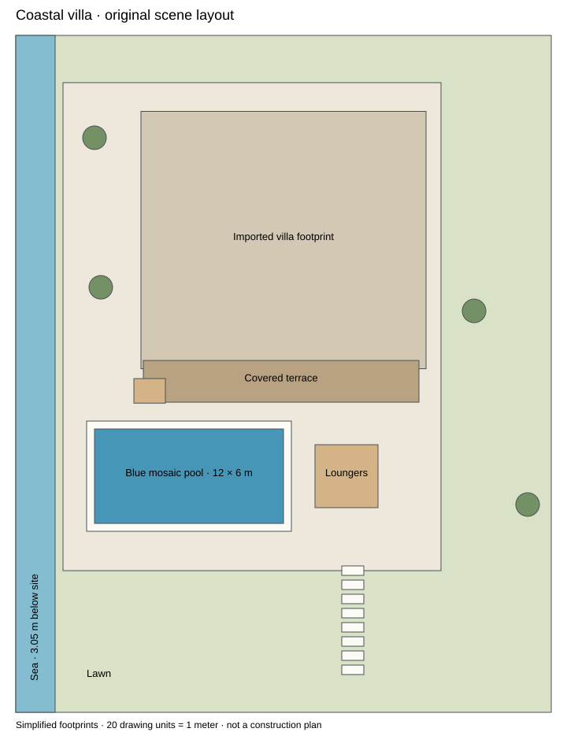

# Coastal villa

`coastal-villa` is a separate daytime exterior: a furnished, single-storey villa,
a 12 × 6 m pool, a planted lawn, a covered terrace and a rocky sea frontage.
The existing apartment presets retain their layouts and rendering settings.
Scene dimensions are in meters. The default camera and output are Full HD.

```bash
./target/release/viewer --backend metal --scene coastal-villa --samples 2048 --bounces 50

./target/release/lumen-rs --backend metal --scene coastal-villa \
  --samples 256 --bounces 50 --denoise --exr --output renders/coastal-villa.png

./target/release/lumen-rs --backend metal --scene coastal-villa \
  --viewpoint scenes/coastal-pool-view.json --samples 512 --bounces 50 \
  --denoise --exr --output renders/coastal-pool.png
```

The viewer supports the same walk/free-flight navigation and automatic refinement
as the apartment. Start with its default Full HD size. Sample count controls
convergence, not mesh detail: the same full meshes are used at every setting.

## Architecture and sourced assets

The architectural direction comes from [MIST/EYRC's Carmel Beach House](https://www.mistarchitects.com/carmelbeachhouse):
low horizontal roofs, deep overhangs, pale mineral surfaces, timber and glazing
opening toward water. The imported [Innerscene four-bedroom villa](https://www.innerscene.com/tools/library/3d-parts/modern-four-bedroom-villa-with-pool-3d-model-ec51544e)
provides an existing floor layout, rooms, kitchen/bathroom fittings, doors and
windows. It is adapted here; this is not a replica of the Carmel property.
The pool and site layout are original and follow the dimensions below.

| Element | Placement / construction |
| --- | --- |
| Villa | Centered at x = 3 m, z = −9 m; source floor at y = 0.12 m |
| Terrace | x = −11…13 m, z = −19…12 m; paving top y = 0.15 m |
| Pool | x = −9…3 m, z = 3…9 m; nominal depth 1.50 m |
| Pool access | Four tiled steps at the house/right end |
| Lounge area | East of the pool, leaving a circulation strip around the coping |
| Lawn | East and south of the terrace, with separate stepping stones |
| Sea | West of the site; surface 3.05 m below the landscape datum |

The terrace uses the complete **Pool Deck Set** and **Canopy Daybed** meshes from
vinish.dev, plus Poly Haven's scanned café furniture and potted plants. The
landscape uses **Coast Line 02**, **Quiver Tree 01**, **Shrub 04** and individual
**Grass Bermuda 01** variants. The coast scan alone retains 756,940 triangles;
each quiver tree retains 150,124. The building source is less geometrically dense
than these scans; its edge bevels, materials and added canopy are architectural
adaptations, not a claim that it is a high-resolution building scan.

Source pixels, UVs, normals and complete source meshes are retained. No geometry
LOD or texture downscaling is used for final rendering. Foliage uses the separate
source opacity maps, including camera, shadow and indirect rays. Exactly constant
packed data channels are represented by scalar material values; repeated models
share their imported material and texture records.

[Credits and modifications](../assets/CREDITS.md) and
[pinned downloads with SHA-256 checksums](../assets/models/coastal-sources.json)
are included. The runtime performs no network downloads. To restore and convert:

```bash
/Applications/Blender.app/Contents/MacOS/Blender --background \
  --python-exit-code 1 --python scripts/prepare-coastal-assets.py
```



## Water and mosaic

The basin has individual 4 cm blue tesserae, recessed grout, beveled tile edges,
small height/color variations and an original gold dolphin silhouette. The gold
is a metallic material on actual submerged tiles. The steps are modeled and
tiled; no opaque foundation crosses the basin.

Water uses a closed dielectric volume with IOR 1.333 and RGB Beer–Lambert
absorption in inverse meters. The pool coefficients are (0.22, 0.045, 0.018), so
longer paths attenuate red more strongly. Reflections, refraction, total internal
reflection and indirect illumination use the existing path tracer. Nothing is
projected onto the pool floor as a fake caustic texture.

A deterministic superposition of 24 directional gravity waves generates both
positions and normals. Wavelengths, directions and phases vary, with deep-water
gravity dispersion for the phase evolution. The 384 × 384 pool grid has 294,912
surface triangles. The ocean has a 512 × 512 displaced near surface and a flat
distant continuation inside one shared closed volume, avoiding internal
refractive walls between patches. This is a static optical surface, not a fluid
simulation or a measured ocean spectrum.

The photographed 4K HDR sky is loaded as linear radiance and supplies both visible
clouds and reflected/indirect light. A finite warm emitter supplies the directional
key. The distant clouds are photographic environment detail, not volumetric clouds.

## Convergence and limits

The preview PNG is denoised; the raw PNG and scene-linear EXR are also saved
locally. Compare the raw image when judging the gold glints, grout and caustics:
denoising can suppress detail at low sample counts. Full HD alone does not imply
that an image has converged. The JSON beside each render records actual samples,
bounces, device, timings and invalid-sample count.

This scene does **not** add a dedicated caustic integrator. Small-source specular
paths can still converge slowly with ordinary path tracing. A relevant next
integrator is [specular manifold sampling](https://rgl.epfl.ch/publications/Zeltner2020Specular),
which explicitly finds specular connections; it requires validated probabilities,
visibility and CPU/Metal agreement before it can replace this baseline. Increasing
wave detail cannot substitute for that transport work. No claim of best-in-market
water rendering or fully converged caustics is made by these previews.
